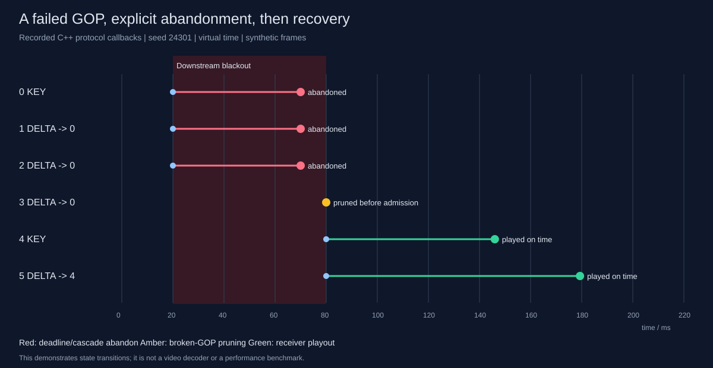

# RUDP-RT: deadline-aware UDP transport for real-time media experiments

English | [简体中文](README_zh.md)

[](https://github.com/Trident-Kraken/realtime-stream-gateway/actions/workflows/ci.yml)


Late media may no longer be useful. This project explores **recovering useful
frames, explicitly abandoning expired frames, and keeping transport windows moving.**

It includes a Linux gateway, reference receiver, virtual-clock simulator,
benchmark runner and GOP recovery demo. Default input is synthetic. The receiver
assembles fragments and classifies playout timing; it does not decode or display video.



## Design and evidence

| Design | Implementation and validation |
|---|---|
| Deadlines and ABANDON | Release expired frame payload; explicitly consume its receive sequence range; retransmit lost ABANDON controls and verify window progress |
| Selective reliability | Sliding window, cumulative ACK, 64-bit SACK, NACK, per-packet RTO backoff; sequence wrap and epoch-qualified control validation |
| Single-writer runtime | epoll/timerfd/eventfd/signalfd, bounded SPSC capture handoff, EAGAIN handling and bounded shutdown |
| Frame dependencies | Cascade abandon, broken-GOP admission pruning and upstream source keyframe-request callback using synthetic metadata |
| Auditable accounting | Independently count session offers; reconcile admissions/closures; unique frame terminal events and fixed benchmark denominators |
| Two validation paths | Virtual-clock faults and JSON replay, plus separate processes and actual UDP sockets under injected faults |

RTT/RTO estimation is RFC 6298-style with Karn filtering and restricted sampling
around hole recovery (ADR-0018), not a complete TCP implementation. Keyframe requests
are source callbacks, not RTCP PLI. Default synthetic frames are all independent;
dependency behavior is covered by dedicated tests and the scripted GOP demo.

## Build and run

Requires Linux, a C++20 compiler, CMake ≥3.24, and Python 3 for tests/tools.
No third-party C++ runtime libraries are required.

```bash
cmake -S . -B build -DCMAKE_BUILD_TYPE=RelWithDebInfo
cmake --build build -j4
ctest --test-dir build --output-on-failure -j1

# Real processes, real UDP, a 400 ms DATA outage on loopback
python3 tools/socket_experiment.py --scenario outage-400ms --reps 1 --out /tmp/rudp-socket

# Recorded GOP event demo and terminal replay
./build/rudp_demo /tmp/gop.json
python3 tools/render_demo.py /tmp/gop.json --svg /tmp/gop.svg --replay
```

86 CTest cases cover unit, property, integration, fault, benchmark-contract and
real-socket scenarios. CI verifies actual sanitizer compilation/linkage and runs
ASan/UBSan and TSan; the dynamic CI badge links to current results.

```bash
cmake -S . -B build-asan -DCMAKE_BUILD_TYPE=Debug -DRUDP_SANITIZE=address \
  -DRUDP_WERROR=OFF -DCMAKE_EXPORT_COMPILE_COMMANDS=ON
cmake --build build-asan -j4
python3 tools/check_sanitizer.py build-asan address
ctest --test-dir build-asan --output-on-failure -E '^system\.' -j1

cmake -S . -B build-tsan -DCMAKE_BUILD_TYPE=Debug -DRUDP_SANITIZE=thread \
  -DRUDP_WERROR=OFF -DCMAKE_EXPORT_COMPILE_COMMANDS=ON
cmake --build build-tsan -j4
python3 tools/check_sanitizer.py build-tsan thread
ctest --test-dir build-tsan --output-on-failure -R '^(unit|integration|fault)\.' -j1
```

## Results and interpretation

30 fps, 12 KB/frame, 10 ms base RTT, independent ±2 ms one-way jitter, 100 ms
sender budget, 60 ms playout wait. Exactly 100 warmup + 10,000 measured source
frames; five seeds `24301..24305`. Mean receiver on-time playout FDR:

| Scenario | UDP | TCP-model | RUDP deadline | RUDP always |
|---|---:|---:|---:|---:|
| IID 5% loss | 0.5959 | 0.5139 | 0.9868 | 0.9872 |
| Burst 20% loss, length 4 | 0.4414 | 0.0000 | 0.8630 | 0.8628 |

- TCP-model retains ordered delivery, fast retransmit and RTO, without SACK or
  congestion control. It does not measure Linux TCP performance.
- Deadline-mode gains vary by seed; these runs do not establish a robust general
  improvement over always-retransmit. Controlled tests separately verify ABANDON
  progress and GOP recovery.
- Session FDR measures sender cumulative-ACK closure. Playout FDR uses a fixed
  source-frame/client denominator, including missing frames; the two are distinct.
- The 60 ms P99 uses a first-valid-arrival-anchored timeline and intentional
  buffering. It is not synchronized capture-to-playout or decoded-video latency.
- Fifteen short real-socket trials cover no loss, IID loss, burst loss, an outage
  and three-client fanout. They validate runtime flow and recovery, not capacity.

See [virtual-clock results](docs/experiments/results.md) and
[real-socket evidence](docs/experiments/socket/README.md) for conditions,
per-seed data, half-ranges, recovery traffic and reproduction commands.
Schema-v2 results supersede the historical schema-v1 numbers.

## Scope and remaining work

This is a transport prototype for controlled, trusted experiment networks. It
has no congestion control, cryptographic authentication, NAT traversal or real
codec integration. `camera_source.cpp` is an experimental adapter not wired into
the default runtime. Long-duration runs, variable media loads, bandwidth
bottlenecks and larger-client capacity measurements remain future work.

Session entrance counts are independent of outcome counts and checked after
sender output routing. Source totals remain derived from consumer admissions and
capture drops. The watchdog detects stalled ACK progress. Bit-identical replay
is tested within one build/toolchain, not guaranteed across C++ standard libraries.

## Further reading

- [Design rationale and debugging notes (Chinese)](docs/design-walkthrough.md)
- [GOP demo](docs/demo/README.md), [validation notes](docs/validation-notes.md)
- [Implementation specification](docs/SPECIFICATION.md), [wire protocol](docs/protocol.md), [ADRs](docs/adr/)
- [Engineering postmortems](docs/DEV-LOG.md), [domain glossary](CONTEXT.md)

[MIT License](LICENSE)
