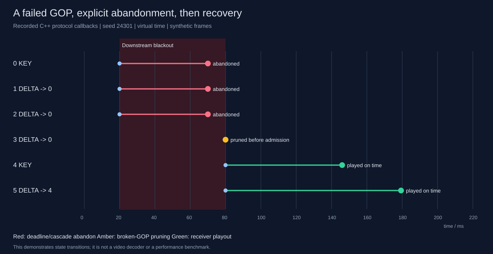

# RUDP-RT：面向实时媒体的截止时间感知 UDP 传输实验系统

[English](README.md) | 简体中文

[](https://github.com/Trident-Kraken/realtime-stream-gateway/actions/workflows/ci.yml)


实时媒体中，完整送达已经过期的帧未必有价值。这个项目研究：**如何在丢包时恢复仍有用的帧，放弃过期帧，并让收发窗口继续推进。**

实现包含 Linux 网关、参考接收端、确定性仿真器、基准工具和 GOP 恢复演示。默认使用合成帧；参考接收端进行分片重组、播放时刻分类与度量，尚未接入真实视频解码和画面显示。



## 值得研究的设计

| 设计 | 实现与验证 |
|---|---|
| 截止时间与 ABANDON | 帧到期后释放媒体负载，显式通知接收端消耗序号区间；ABANDON 丢失后重发，测试窗口持续推进 |
| 有选择的可靠传输 | 滑动窗口、累计 ACK、64 位 SACK、NACK、逐包 RTO 退避；序号回绕与控制报文会话代际校验 |
| 单写者运行时 | epoll、timerfd、eventfd、signalfd；采集与网络线程通过有界 SPSC 队列交接，处理 EAGAIN 和有界停机 |
| 帧依赖处理 | 按合成元数据级联放弃依赖帧，拒绝破损 GOP 的新帧，并向媒体源回调关键帧请求 |
| 可验证的计量 | 会话入口独立计数，与准入、关闭事件对账；按 frame ID 记录唯一终态，固定基准测量分母 |
| 可复现与实网验证 | 虚拟时钟故障注入、JSON 重放，另有独立进程和真实 UDP socket 的弱网实验 |

RTT/RTO 使用 RFC 6298 风格估计及 Karn 过滤，并针对空洞恢复限制采样（ADR-0018），不是完整的 TCP 实现。关键帧请求是源接口回调，未实现 RTCP PLI。默认合成源全部为独立帧；GOP 依赖由专门演示和测试覆盖。

## 构建与运行

需要 Linux、C++20 编译器、CMake ≥3.24、Python 3（测试及实验脚本）。无第三方 C++ 运行库依赖。

```bash
cmake -S . -B build -DCMAKE_BUILD_TYPE=RelWithDebInfo
cmake --build build -j4
ctest --test-dir build --output-on-failure -j1

# 真实网关/客户端进程，经回环 UDP 代理注入 400 ms DATA 断流
python3 tools/socket_experiment.py --scenario outage-400ms --reps 1 --out /tmp/rudp-socket

# 可重放的 GOP 事件演示
./build/rudp_demo /tmp/gop.json
python3 tools/render_demo.py /tmp/gop.json --svg /tmp/gop.svg --replay
```

当前 86 项 CTest 覆盖单元、属性、集成、故障、基准契约及真实 socket 场景。CI 校验实际编译插桩和运行库链接，并执行 ASan/UBSan、TSan；状态以顶部动态 CI 链接为准。

```bash
cmake -S . -B build-asan -DCMAKE_BUILD_TYPE=Debug -DRUDP_SANITIZE=address \
  -DRUDP_WERROR=OFF -DCMAKE_EXPORT_COMPILE_COMMANDS=ON
cmake --build build-asan -j4
python3 tools/check_sanitizer.py build-asan address
ctest --test-dir build-asan --output-on-failure -E '^system\.' -j1

cmake -S . -B build-tsan -DCMAKE_BUILD_TYPE=Debug -DRUDP_SANITIZE=thread \
  -DRUDP_WERROR=OFF -DCMAKE_EXPORT_COMPILE_COMMANDS=ON
cmake --build build-tsan -j4
python3 tools/check_sanitizer.py build-tsan thread
ctest --test-dir build-tsan --output-on-failure -R '^(unit|integration|fault)\.' -j1
```

## 实验结果与边界

30 fps、12 KB/帧、10 ms 基础 RTT、单向抖动 ±2 ms、100 ms 发送端预算、60 ms 播放等待。
固定 100 帧预热及 10,000 帧测量区间，五个种子 `24301..24305`。表中为接收端按时播放送达率均值：

| 场景 | UDP | TCP-model | RUDP deadline | RUDP always |
|---|---:|---:|---:|---:|
| 5% IID 丢包 | 0.5959 | 0.5139 | 0.9868 | 0.9872 |
| 20% 突发丢包，长度 4 | 0.4414 | 0.0000 | 0.8630 | 0.8628 |

- TCP-model 是保留按序交付、快速重传和 RTO 的用户态模型，未实现 SACK 或拥塞控制，不能代表 Linux TCP 的实际性能。
- Deadline 相对纯重传的收益随种子变化，这组数据不支持普遍显著提升的结论。ABANDON 的状态推进及 GOP 恢复另有受控演示验证。
- 会话 FDR 依据发送端累计 ACK 关闭；播放 FDR 按固定的源帧/客户端分母统计，二者分开报告。
- 60 ms P99 来自首包到达锚定的播放时间线，包含人为播放等待；不能当作采集到播放或解码延迟。
- 实网短时实验：无丢包、随机丢包、突发丢包、断流及三客户端共 15 次。它们验证真实运行路径和恢复能力，尚不能证明容量或生产部署表现。

完整参数、逐种子结果、半极差、重传开销及复现命令见 [仿真报告](docs/experiments/results.md) 和 [真实 socket 报告](docs/experiments/socket/README.md)。旧版 schema-v1 基准数字已由 schema-v2 取代。

## 范围与后续工作

目前定位为可信实验网络中的传输系统原型。尚未实现拥塞控制、加密认证、NAT 穿透、真实编解码及完整摄像头接入；`camera_source.cpp` 是未接入默认运行路径的实验适配器。仍需长时间运行、多种负载、带宽瓶颈和更多客户端的容量测试。

会话入口计数独立于终态统计，路由输出批次后检查守恒；源账本总量仍由消费端准入数和采集丢弃数推导。运行时 Watchdog 检查 ACK 推进停滞。重放在同一构建/工具链内验证，不承诺跨标准库的随机分布结果比特一致。

## 阅读入口

- [校招项目介绍、简历与面试准备](docs/interview-guide.md)
- [GOP 演示说明](docs/demo/README.md)
- [逐项补强与验证记录](docs/improvement-plan.md)
- [实现规范](docs/SPECIFICATION.md)、[线协议](docs/protocol.md)、[架构决策](docs/adr/)
- [开发复盘](docs/DEV-LOG.md)、[领域术语](CONTEXT.md)

[MIT License](LICENSE)
