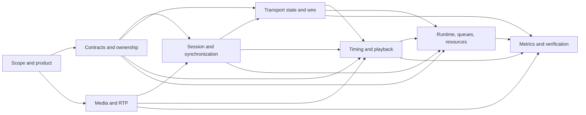

# RUDP-RT Decision Dependency Audit

## 审计范围

本报告以当前设计文档和 `AUDIT-IMPLEMENTATION-DETERMINISM.md` 中的 60 项 `Missing Decision` 为输入。它只分析决策之间的依赖关系和解决顺序，不替设计者选择答案，也不修改任何设计文档。

依赖关系采用以下约定：

- 只列直接依赖；传递依赖不重复展开。
- “下游”表示如果上游决策改变，必须重新审视的直接决策。
- “协议约束”表示必须形成双方一致的可互操作行为；“工程选择”表示实现方式可以不同，但外部契约/资源/验证结果必须一致；“混合”表示两者都有。
- “Design Freeze 前”针对的是文档冻结，不是代码提交。标为“是”的决策不能由某个实现者在编码中隐式决定。

## A. Decision Dependency Graph

### A.1 Cluster-level graph



### A.2 Critical decision chains

```text
MD-01 -> MD-02/03/04/05 -> MD-06/07/08/09/10
      -> MD-11 -> MD-12 -> MD-13 -> MD-14 -> MD-15 -> MD-17
      -> MD-16 -> MD-18 -> MD-20 -> MD-21 -> MD-22/23/24
      -> MD-25/26/27 -> MD-28 -> MD-29/30
      -> MD-31/32/33/34/35
      -> MD-36/37/38 -> MD-39/40 -> MD-41/42 -> MD-43/44/45
      -> MD-47/48/49/50/52/53/54
      -> MD-55 -> MD-56/57/58 -> MD-59 -> MD-60
```

上述代码块是便于审阅的主链，不表示每个斜杠项之间有顺序关系。实际决策应按集群并行推进，但必须遵守各条目的直接依赖。

### A.3 Critical path

最长且最容易返工的路径是：

```text
交付边界
  -> 客户端/媒体/模块契约
  -> Session identity + Join/Restart/Heartbeat
  -> 初始 ISN/ACK/SYNC_START
  -> sender/receiver/frame 状态粒度
  -> ACK/SACK/NACK/ABANDON 交互
  -> deadline/EXPIRED/timeout/retry
  -> queue/ownership/timer/error/shutdown
  -> FDR/test oracle/benchmark
```

如果在 `ACK/SACK/NACK/ABANDON` 或 `deadline/EXPIRED` 之后才发现 MD-01、MD-04、MD-06 或 MD-13 未冻结，通常会同时返工协议对象、队列所有权、timer 和测试 oracle。

## B. Critical-Path Decisions

以下不是按 ID 排序，而是按“未决时会阻断最多下游”的顺序排列：

1. **MD-01 交付物边界**：决定是否需要完整 client、playout、Camera 和真实端到端 API。
2. **MD-02 进程与部署拓扑**：决定跨模块通信是函数、线程队列还是 UDP。
3. **MD-04 媒体帧 API 契约** 与 **MD-05 媒体格式/RTP profile**：决定 packetizer、frame_id、timestamp 和 payload ownership。
4. **MD-06 模块所有权边界**、**MD-07 模块接口形态**、**MD-08 Clock API**、**MD-09 网络抽象 API**：决定可测试的模块连接方式和并发边界。
5. **MD-11 Join/Restart/Heartbeat**、**MD-12 Session identity**、**MD-13 初始 ISN/ACK**、**MD-14 epoch/token**、**MD-15 Session 状态机**：决定所有控制报文和旧事件是否能被唯一解释。
6. **MD-16 sender packet/frame 状态粒度**、**MD-17 receiver sync 切换**、**MD-18 descriptor 定型**、**MD-19 frame-id 缺口**：决定数据面状态是否能收敛。
7. **MD-20 入窗失败回滚**、**MD-21 ACK 单调性**、**MD-22 SACK 生命周期**、**MD-23 NACK 输入**、**MD-24 ABANDON 区间**：决定序列终态、恢复和互操作。
8. **MD-25 Deadline 起点**、**MD-26 RTP 播放时间**、**MD-27 EXPIRED 效果**、**MD-28 timeout 优先级**、**MD-29 timer identity**、**MD-30 retry 最终失败**：决定时间和 liveness。
9. **MD-31 socket error**、**MD-32 malformed commit**、**MD-33 oversized datagram**、**MD-34/35 wire/RTP compatibility**：决定边界输入是否会破坏上述状态。
10. **MD-36/37 ownership**、**MD-38/39 queue**、**MD-40 SPSC**、**MD-41/42 scheduling**、**MD-43/44/45 runtime lifecycle**、**MD-47/48/49/50/52 resource/lifecycle**：决定真实运行时能否兑现协议语义。
11. **MD-55/56/57/58/59 metrics and tests**：只能在前述行为冻结后形成有效 oracle。

## C. Decision Clusters

### Cluster 1: Product, delivery and media scope

Members: **MD-01, MD-02, MD-03, MD-04, MD-05**。

这组决定系统到底交付什么、输入是什么、协议面对什么媒体和部署边界。它们是所有公开接口和验收指标的上游。

### Cluster 2: Contracts, ownership and platform abstractions

Members: **MD-06, MD-07, MD-08, MD-09, MD-10**。

这组把架构图变成可实现的对象、调用、时间和网络契约。没有它们，后续协议状态只能以隐含指针、隐含线程和隐含时钟存在。

### Cluster 3: Session identity and synchronization

Members: **MD-11, MD-12, MD-13, MD-14, MD-15, MD-17**。

这组决定一个控制报文属于哪个会话、会话从什么序列开始、旧事件如何隔离，以及 receiver 如何从预同步状态进入正常状态。

### Cluster 4: Transport and frame protocol

Members: **MD-16, MD-18, MD-19, MD-20, MD-21, MD-22, MD-23, MD-24**。

这组决定 sender/receiver 的可观察协议行为。它必须在 timer、queue 和 metrics 之前冻结。

### Cluster 5: Time, playback and retry

Members: **MD-25, MD-26, MD-27, MD-28, MD-29, MD-30**。

这组把“实时”转化成可执行的 deadline、playout、timeout 和 retry 规则。

### Cluster 6: Wire validation and error semantics

Members: **MD-31, MD-32, MD-33, MD-34, MD-35, MD-51**。

这组决定坏输入、系统错误和版本/格式差异如何进入状态机，而不是停留在错误枚举名称上。

### Cluster 7: Runtime concurrency, queues and resources

Members: **MD-36, MD-37, MD-38, MD-39, MD-40, MD-41, MD-42, MD-43, MD-44, MD-45, MD-47, MD-48, MD-49, MD-50, MD-52, MD-53, MD-54**。

这组决定单 Reactor 设计能否在真实线程、socket、timer、过载、启动和关闭中保持安全。

### Cluster 8: Metrics, verification and project governance

Members: **MD-46, MD-55, MD-56, MD-57, MD-58, MD-59, MD-60**。

这组决定什么算成功、如何重放、如何比较和何时发布。它不能反过来偷偷定义协议语义。

## D. Per-decision Analysis

### MD-01 — 交付物边界

- **Exact missing decision**：是否必须实现客户端、接收端 Jitter Buffer、播放/消费线程、Camera 适配器，还是只交付 Gateway 和协议库。
- **Category**：产品范围 / 交付边界。
- **Why it blocks implementation**：FDR 分子、receiver 行为和端到端完成条件依赖这些组件是否真实存在。
- **Dependencies**：无；它是本图的根节点之一。
- **Decisions that depend on it**：MD-02, MD-03, MD-04, MD-05, MD-06, MD-07, MD-09, MD-38, MD-46, MD-55, MD-59, MD-60。
- **Protocol-mandated or engineering choice**：工程/产品选择。
- **Risk if incorrect**：实现边界、测试拓扑和性能目标完全不同；可能完成了 Gateway 却没有可验证的 receiver。
- **Must be decided before Design Freeze**：是。
- **Recommended order**：O1，第一项个人决策。

### MD-02 — 进程与部署拓扑

- **Exact missing decision**：Gateway、client、虚拟网络、fault injector、metrics 是否在同一进程、不同线程或不同进程；真实 socket 集成测试的进程边界是什么。
- **Category**：架构 / 部署 / 测试拓扑。
- **Why it blocks implementation**：决定跨边界通信、故障注入、启动顺序和公开 API 是函数、线程消息还是 UDP。
- **Dependencies**：MD-01。
- **Decisions that depend on it**：MD-07, MD-09, MD-38, MD-40, MD-41, MD-45, MD-47, MD-48, MD-59。
- **Protocol-mandated or engineering choice**：工程选择，但一旦跨进程，wire/API 约束成为强制契约。
- **Risk if incorrect**：独立实现无法互通；虚拟测试可能避开真实 socket、线程和故障边界。
- **Must be decided before Design Freeze**：是，至少冻结交付和测试拓扑；具体部署脚本可后置。
- **Recommended order**：O1，与 MD-01 同批。

### MD-03 — Stream 配置和生命周期

- **Exact missing decision**：stream_id 从哪里配置、何时生效、是否允许运行时增删、一个 stream 是否只有一个源帧序列，以及未配置 stream 的配置存储格式。
- **Category**：配置 / session / 多客户端。
- **Why it blocks implementation**：Join admission、stream lookup、Packetizer 和 fan-out 都需要稳定的 stream owner。
- **Dependencies**：MD-01, MD-02。
- **Decisions that depend on it**：MD-04, MD-11, MD-12, MD-54, MD-55, MD-59。
- **Protocol-mandated or engineering choice**：混合；配置来源是工程选择，stream identity/lifecycle 是协议可观察行为。
- **Risk if incorrect**：未知 stream、重复 stream 和运行时修改会产生不同 session 或数据源；客户端无法互操作。
- **Must be decided before Design Freeze**：是。
- **Recommended order**：O1。

### MD-04 — 媒体帧 API 契约

- **Exact missing decision**：输入帧对象包含哪些字段（bytes、length、frame_id、RTP timestamp、capture time、format、deadline），字段由谁生成，payload 是否可变。
- **Category**：媒体 API / 数据契约。
- **Why it blocks implementation**：Packetizer、deadline、RTP timestamp、FDR 和 ownership 不能从“媒体分片”文字推导。
- **Dependencies**：MD-01, MD-03, MD-05, MD-08。
- **Decisions that depend on it**：MD-06, MD-07, MD-16, MD-18, MD-19, MD-25, MD-33, MD-36, MD-37, MD-55, MD-59。
- **Protocol-mandated or engineering choice**：混合；C++ 类型是工程选择，字段语义和时间/编号来源是协议契约。
- **Risk if incorrect**：不同实现产生不同 frame_id/timestamp、复制/借用规则和 deadline；数据可能 UAF 或不可比较。
- **Must be decided before Design Freeze**：是。
- **Recommended order**：O1/O2 交界，在媒体格式后、ownership 前。

### MD-05 — 媒体格式与 Camera 边界

- **Exact missing decision**：Synthetic Frame 和 Camera 输出的编码、像素格式、尺寸、帧率、timestamp 来源和格式变化行为。
- **Category**：媒体 / RTP 应用 profile。
- **Why it blocks implementation**：决定 RTP payloadization、frame_count、MTU 和 benchmark packet-count 分布。
- **Dependencies**：MD-01, MD-02。
- **Decisions that depend on it**：MD-03, MD-04, MD-26, MD-34, MD-59, MD-60。
- **Protocol-mandated or engineering choice**：混合；项目可选择支持范围，但选定格式/profile 后必须形成协议契约。
- **Risk if incorrect**：Packetizer 和 client 无法互通；验收结果随帧大小和编码格式变化。
- **Must be decided before Design Freeze**：是（Synthetic 格式和 RTP profile）；Camera 的具体设备适配可明确标为 deferred。
- **Recommended order**：O1，MD-01 后。

### MD-06 — 模块所有权边界

- **Exact missing decision**：Capture、Packetizer、RTP、RUDP sender、Socket adapter、Session Manager、Metrics 各自拥有还是借用哪些对象。
- **Category**：模块边界 / 内存所有权。
- **Why it blocks implementation**：决定 move/copy/free、fan-out 和跨线程对象的安全生命周期。
- **Dependencies**：MD-01, MD-02, MD-04。
- **Decisions that depend on it**：MD-07, MD-16, MD-36, MD-37, MD-38, MD-46。
- **Protocol-mandated or engineering choice**：工程选择，但 ownership 结果是 correctness 契约。
- **Risk if incorrect**：double free、UAF、隐式共享和不同 session 间数据污染；性能峰值也会不同。
- **Must be decided before Design Freeze**：是，至少冻结跨模块 ownership graph。
- **Recommended order**：O2。

### MD-07 — 模块接口形态

- **Exact missing decision**：模块之间使用同步函数、回调、事件、消息队列还是返回值；调用是否只发生在 Reactor 线程。
- **Category**：API / 并发边界。
- **Why it blocks implementation**：架构图不能决定重入、阻塞、线程安全和错误传播方式。
- **Dependencies**：MD-01, MD-02, MD-06。
- **Decisions that depend on it**：MD-08, MD-09, MD-31, MD-41, MD-44, MD-45, MD-46, MD-51。
- **Protocol-mandated or engineering choice**：工程选择；公开网络和事件语义仍必须一致。
- **Risk if incorrect**：一人写纯状态机，另一人写直接 socket callback，模块无法组合，Reactor 可能被阻塞。
- **Must be decided before Design Freeze**：是，冻结行为/API 契约；类名和 ABI 可后置。
- **Recommended order**：O2。

### MD-08 — Clock API 契约

- **Exact missing decision**：`IClock::now()` 的类型、单位、精度、是否允许时间倒退、虚拟时间如何推进，以及一个 session 是否可使用多个 clock。
- **Category**：时间抽象 / 测试契约。
- **Why it blocks implementation**：deadline、RTO、playout、timer heap 和确定性测试都依赖同一时间语义。
- **Dependencies**：MD-01, MD-02, MD-07。
- **Decisions that depend on it**：MD-09, MD-25, MD-26, MD-28, MD-29, MD-43, MD-57。
- **Protocol-mandated or engineering choice**：混合；时间单位/API 是工程选择，但 deadline/playout 的时钟语义是协议契约。
- **Risk if incorrect**：测试时钟和生产 timer 不等价；取整/倒退会改变 retry 和 EXPIRED。
- **Must be decided before Design Freeze**：是。
- **Recommended order**：O2。

### MD-09 — 网络抽象 API

- **Exact missing decision**：虚拟网络和真实 UDP 是否共享同一接口；send/receive 返回值、地址类型、时间戳、截断标志、EAGAIN 表示和 ownership 如何表达。
- **Category**：网络 API / 测试抽象。
- **Why it blocks implementation**：协议必须知道 datagram 是否完整、是否成功发出及错误归属。
- **Dependencies**：MD-02, MD-07, MD-08。
- **Decisions that depend on it**：MD-10, MD-11, MD-12, MD-20, MD-31, MD-33, MD-41, MD-43, MD-53, MD-54。
- **Protocol-mandated or engineering choice**：工程选择，但 send/receive/error 行为必须冻结。
- **Risk if incorrect**：虚拟网络测试绿而真实 socket 行为不同；partial send 和 EAGAIN 无法进入状态机。
- **Must be decided before Design Freeze**：是。
- **Recommended order**：O2。

### MD-10 — 配置校验矩阵

- **Exact missing decision**：W、`max_frame_packets`、payload、D、playout_delay、RTO、buffer、max_sessions、预算等的合法范围和交叉约束。
- **Category**：配置 / 防御性约束。
- **Why it blocks implementation**：默认值不说明非法组合是拒绝、clamp 还是运行时退化。
- **Dependencies**：MD-03, MD-04, MD-05, MD-08, MD-09。
- **Decisions that depend on it**：MD-16, MD-20, MD-24, MD-42, MD-53, MD-59。
- **Protocol-mandated or engineering choice**：工程选择，但不相容配置的结果必须一致。
- **Risk if incorrect**：窗口/帧大小/deadline 数学不成立；两端静态配置不一致时静默丢包。
- **Must be decided before Design Freeze**：是。
- **Recommended order**：O2，作为进入协议冻结的 gate。

### MD-11 — Join/Restart/Heartbeat 的状态与消息区分

- **Exact missing decision**：PING 的角色、重复 PING 的副作用、PONG 的请求关联、会话建立时机和客户端重启识别方式。
- **Category**：session control / wire protocol。
- **Why it blocks implementation**：当前 PING 既是 join/restart 又是 heartbeat；不先区分就没有稳定 session。
- **Dependencies**：MD-03, MD-09, MD-10。
- **Decisions that depend on it**：MD-12, MD-13, MD-14, MD-15, MD-17, MD-28, MD-30, MD-48, MD-50, MD-54。
- **Protocol-mandated or engineering choice**：协议约束。
- **Risk if incorrect**：正常保活销毁会话，延迟 Join 重建新会话，数据和 anchor 反复丢失。
- **Must be decided before Design Freeze**：是。
- **Recommended order**：O3，协议控制面第一项。

### MD-12 — Session identity 与 endpoint 变化

- **Exact missing decision**：session key 是否包含源端口、地址族、本地 stream、epoch/token；客户端源端口或 IP 变化时是迁移、重连还是新 session。
- **Category**：session identity / endpoint。
- **Why it blocks implementation**：没有唯一 identity 就无法路由 ACK/NACK/DATA，也无法定义旧事件。
- **Dependencies**：MD-03, MD-09, MD-11。
- **Decisions that depend on it**：MD-13, MD-14, MD-15, MD-50, MD-53, MD-54。
- **Protocol-mandated or engineering choice**：混合；具体 key 是工程选择，双方识别和变化行为是协议契约。
- **Risk if incorrect**：旧/新端点合并或分裂，跨 NAT/端口变化造成 session 泄漏或错收。
- **Must be decided before Design Freeze**：是。
- **Recommended order**：O3。

### MD-13 — 初始 ISN、recv_next 和 ACK 无值状态

- **Exact missing decision**：Gateway 如何把随机 ISN 告知 client，receiver 在 SYNC_START 前的 `recv_next` 和 ACK 如何表示，ACK 是否允许“尚未建立序列域”。
- **Category**：序列初始化 / 握手。
- **Why it blocks implementation**：首包丢失和初始 NACK/ACK 没有唯一基线。
- **Dependencies**：MD-11, MD-12。
- **Decisions that depend on it**：MD-14, MD-15, MD-17, MD-21, MD-24, MD-57。
- **Protocol-mandated or engineering choice**：协议约束。
- **Risk if incorrect**：receiver 无法分类首个 DATA，sender 可能接受 future ACK 或永久等待同步。
- **Must be decided before Design Freeze**：是。
- **Recommended order**：O3。

### MD-14 — Epoch/session token 与旧报文隔离

- **Exact missing decision**：是否需要 epoch/token、放在哪个报文、如何验证、随机 ISN 是否足够以及旧 ACK/NACK/DATA 的最终处理。
- **Category**：协议隔离 / 安全。
- **Why it blocks implementation**：随机 ISN 只有概率性污染说明，不能唯一解释旧控制报文。
- **Dependencies**：MD-11, MD-12, MD-13。
- **Decisions that depend on it**：MD-15, MD-21, MD-23, MD-50, MD-54。
- **Protocol-mandated or engineering choice**：混合；是否加字段是架构/安全选择，选定后的验证是协议约束。
- **Risk if incorrect**：旧 ACK 释放新 session 资源，旧 Join 重置新 session，控制面可被伪造。
- **Must be decided before Design Freeze**：是，除非明确把概率性隔离写为非目标并限制运行环境。
- **Recommended order**：O3。

### MD-15 — 完整 Session 状态机

- **Exact missing decision**：`NEW/NEGOTIATING/ESTABLISHED/QUIET/DEAD/CLOSING` 等状态是否存在、各事件的合法性、状态进入/退出副作用。
- **Category**：session state machine。
- **Why it blocks implementation**：Join、保持、timeout、重连和 teardown 目前只有散文，没有唯一事件表。
- **Dependencies**：MD-11, MD-12, MD-13, MD-14。
- **Decisions that depend on it**：MD-16, MD-17, MD-28, MD-30, MD-45, MD-48, MD-50, MD-52。
- **Protocol-mandated or engineering choice**：协议约束。
- **Risk if incorrect**：同一报文在不同实现中被接受/丢弃，session 半初始化或重复 teardown。
- **Must be decided before Design Freeze**：是。
- **Recommended order**：O3，作为 session cluster 的收口。

### MD-16 — Sender packet/frame 状态粒度

- **Exact missing decision**：Outstanding 是帧级还是同时包含逐包状态；部分已发送、SACK、逐包重传、逐包 RTO 如何表达。
- **Category**：sender state / retransmission。
- **Why it blocks implementation**：文档字段是帧级，NACK/SACK/RTO 行为是逐 seq；没有唯一数据模型。
- **Dependencies**：MD-04, MD-06, MD-10, MD-15。
- **Decisions that depend on it**：MD-18, MD-20, MD-21, MD-22, MD-23, MD-24, MD-30, MD-31, MD-36, MD-37, MD-42, MD-49。
- **Protocol-mandated or engineering choice**：混合；内部结构可选，但逐包可观察行为必须一致。
- **Risk if incorrect**：部分发送、Karn、SACK 和 deadline 的结果随实现变化；可能永久留洞。
- **Must be decided before Design Freeze**：是。
- **Recommended order**：O4。

### MD-17 — Receiver sync-to-normal 状态切换

- **Exact missing decision**：SYNC_START 到达、丢失、重复、后续包反推和预同步缓存何时原子切换为正常窗口。
- **Category**：receiver synchronization。
- **Why it blocks implementation**：没有切换点就无法决定预同步包是否可 ACK、如何加入正常 reorder。
- **Dependencies**：MD-13, MD-15, MD-18。
- **Decisions that depend on it**：MD-19, MD-21, MD-24, MD-55, MD-57。
- **Protocol-mandated or engineering choice**：协议约束。
- **Risk if incorrect**：首包丢失时重复锚定、错误跳洞或永久无法建立窗口。
- **Must be decided before Design Freeze**：是。
- **Recommended order**：O4，和 frame descriptor 一起冻结。

### MD-18 — Frame descriptor 定型与冲突

- **Exact missing decision**：首次 frame_id 包是否固定 `frame_count/rtp_timestamp/seq range`，冲突包丢弃单包、整帧还是关闭 session。
- **Category**：frame assembly / protocol validation。
- **Why it blocks implementation**：frame range、完整性和 RTP 时间线都依赖 descriptor 的唯一提交规则。
- **Dependencies**：MD-04, MD-05, MD-16。
- **Decisions that depend on it**：MD-17, MD-19, MD-24, MD-26, MD-27, MD-32, MD-34, MD-56。
- **Protocol-mandated or engineering choice**：协议约束。
- **Risk if incorrect**：同 frame_id 被拼成不同帧，永远 COMPLETE 或交付错误媒体。
- **Must be decided before Design Freeze**：是。
- **Recommended order**：O4。

### MD-19 — 未入窗 frame_id 缺口

- **Exact missing decision**：capture drop、pre-admission drop、窗口等待超时和 join 边界造成的 frame_id 缺口如何对 receiver 可见、何时跳过。
- **Category**：frame ordering / drop semantics。
- **Why it blocks implementation**：D-18 让未入窗帧无 seq，而交付又按 frame_id 排序；两者必须取唯一语义。
- **Dependencies**：MD-03, MD-04, MD-17, MD-18。
- **Decisions that depend on it**：MD-27, MD-48, MD-55, MD-56。
- **Protocol-mandated or engineering choice**：协议/产品混合；缺口可见性是协议，是否要求严格 frame order 是产品语义。
- **Risk if incorrect**：后续完整帧永久等待，或 receiver 自主跳洞造成不同客户端行为。
- **Must be decided before Design Freeze**：是。
- **Recommended order**：O4。

### MD-20 — 帧级原子入窗的失败回滚

- **Exact missing decision**：一帧“同时获得连续 seq、同时入窗”后，分配失败、部分 send、预算耗尽、EAGAIN 时如何回滚或了结所有 seq。
- **Category**：sender admission / failure state。
- **Why it blocks implementation**：原子入窗不等于原子写 socket；失败必须仍满足序列终态。
- **Dependencies**：MD-09, MD-10, MD-16, MD-31, MD-42。
- **Decisions that depend on it**：MD-21, MD-22, MD-23, MD-24, MD-28, MD-30, MD-33, MD-49, MD-52。
- **Protocol-mandated or engineering choice**：混合；回滚/ABANDON 的外部结果是协议约束，内部预留方式是工程选择。
- **Risk if incorrect**：未发送 seq 永远成为洞，窗口死锁或错误地复活 DATA。
- **Must be decided before Design Freeze**：是。
- **Recommended order**：O4。

### MD-21 — ACK 合法性与单调性

- **Exact missing decision**：stale ACK、future ACK、跨未分配 seq 的 ACK、重复 ACK、ACK 跳过 ABANDON 前后的处理和错误计数。
- **Category**：ACK protocol / sender state。
- **Why it blocks implementation**：ACK 是推进 send_base、释放资源和 RTT 采样的唯一外部输入。
- **Dependencies**：MD-13, MD-14, MD-16, MD-17, MD-20。
- **Decisions that depend on it**：MD-22, MD-23, MD-24, MD-28, MD-30, MD-31, MD-49。
- **Protocol-mandated or engineering choice**：协议约束。
- **Risk if incorrect**：future/stale ACK 销账错误，重传和窗口行为不互操作。
- **Must be decided before Design Freeze**：是。
- **Recommended order**：O4。

### MD-22 — SACK 生命周期与 ABANDON 交互

- **Exact missing decision**：SACKed payload 是保留字节还是只保留序列标记；ABANDON 覆盖已 SACK 包时 ACK/SACK 如何生成、何时释放。
- **Category**：SACK / ownership / ABANDON。
- **Why it blocks implementation**：no-reneging、flush 和 payload 释放对同一对象提出不同要求。
- **Dependencies**：MD-16, MD-20, MD-21。
- **Decisions that depend on it**：MD-24, MD-30, MD-37, MD-56。
- **Protocol-mandated or engineering choice**：协议约束加 ownership 实现选择。
- **Risk if incorrect**：sender 永久跳过已报告包，或 receiver 内存无法回收；不同实现 ACK 不同。
- **Must be decided before Design Freeze**：是。
- **Recommended order**：O4。

### MD-23 — NACK 输入处理

- **Exact missing decision**：NACK 中重复 seq、已消耗 seq、SACKed seq、ABANDONED seq、窗口外 seq 的逐项裁决、排序、合并和速率限制。
- **Category**：NACK protocol / control backpressure。
- **Why it blocks implementation**：NACK 是外部可控的快路径，必须定义哪些项改变 retry/timer。
- **Dependencies**：MD-14, MD-16, MD-20, MD-21, MD-22。
- **Decisions that depend on it**：MD-24, MD-28, MD-30, MD-31, MD-42, MD-54。
- **Protocol-mandated or engineering choice**：混合；逐项协议裁决强制，限速算法是工程选择。
- **Risk if incorrect**：重复/伪造 NACK 造成重传风暴、饥饿或错误 session 关闭。
- **Must be decided before Design Freeze**：是。
- **Recommended order**：O4/O6 交界，先冻结行为再定限速实现。

### MD-24 — ABANDON 区间规范化

- **Exact missing decision**：区间排序、相邻/重叠合并、跨回绕表示、单包超 64 区间时分片、重复区间、旧区间和未来区间的处理。
- **Category**：ABANDON wire/state。
- **Why it blocks implementation**：ABANDON 是填洞、销账和 liveness 的核心对象。
- **Dependencies**：MD-13, MD-14, MD-16, MD-17, MD-18, MD-20, MD-21, MD-22, MD-23。
- **Decisions that depend on it**：MD-28, MD-30, MD-31, MD-32, MD-56。
- **Protocol-mandated or engineering choice**：协议约束。
- **Risk if incorrect**：一端合并/接受而另一端拒绝，window 不推进或旧区间被误判越界。
- **Must be decided before Design Freeze**：是。
- **Recommended order**：O4，transport cluster 的收口。

### MD-25 — Deadline 起点、量化和零值语义

- **Exact missing decision**：D 从 capture、frame creation、入队、首次发送还是入窗开始；毫秒取整方向；remaining=0 是否可发送；超过 D 如何编码。
- **Category**：deadline / clock semantics。
- **Why it blocks implementation**：sender 的每个 recovery/abandon 判断都依赖同一个起点和量化方式。
- **Dependencies**：MD-04, MD-08, MD-10, MD-16。
- **Decisions that depend on it**：MD-20, MD-27, MD-28, MD-30, MD-55, MD-58, MD-59。
- **Protocol-mandated or engineering choice**：协议约束。
- **Risk if incorrect**：同一帧在不同实现中拥有不同剩余寿命；benchmark 和 FDR 无法比较。
- **Must be decided before Design Freeze**：是。
- **Recommended order**：O5。

### MD-26 — Playback timeline 与 RTP clock

- **Exact missing decision**：RTP clock rate、PT、SSRC、timestamp wrap、帧率变化、anchor 重建、暂停/恢复和负 timestamp delta 的行为。
- **Category**：RTP / playout semantics。
- **Why it blocks implementation**：`/90000` 不能单独定义可互操作的播放时间线。
- **Dependencies**：MD-05, MD-08, MD-17, MD-18, MD-34。
- **Decisions that depend on it**：MD-27, MD-34, MD-56, MD-58, MD-59。
- **Protocol-mandated or engineering choice**：混合；支持范围是工程/产品选择，选定 profile 的时间规则是协议约束。
- **Risk if incorrect**：EXPIRED、late、ontime 和 P99 结果全部偏移；client 无法正确播放。
- **Must be decided before Design Freeze**：是，至少冻结支持的 RTP profile；扩展格式可后置。
- **Recommended order**：O5，与 MD-25 并行但在 MD-05 后。

### MD-27 — Receiver EXPIRED 的协议效果

- **Exact missing decision**：本地 playout 过期是否能推进 `recv_next`、是否要生成任何上报、与后到 DATA/ABANDON 的优先级是什么。
- **Category**：receiver state / deadline。
- **Why it blocks implementation**：FrameState 有 EXPIRED，但 sequence advancement 没有对应状态。
- **Dependencies**：MD-18, MD-19, MD-25, MD-26。
- **Decisions that depend on it**：MD-28, MD-30, MD-55, MD-56, MD-58。
- **Protocol-mandated or engineering choice**：协议约束。
- **Risk if incorrect**：过期帧仍堵住 ACK/window，或不同 receiver 自主跳洞导致互操作差异。
- **Must be decided before Design Freeze**：是。
- **Recommended order**：O5。

### MD-28 — Timeout 类型之间的优先级

- **Exact missing decision**：frame deadline、RTO、NACK 抑制、ABANDON retry、PING、ACK timeout、session timeout、watchdog 同时到期时的顺序和互斥关系。
- **Category**：timer / state transition。
- **Why it blocks implementation**：单 timerfd 会把多个事件送到同一 Reactor，文档没有 tie-break。
- **Dependencies**：MD-08, MD-11, MD-15, MD-16, MD-20, MD-21, MD-22, MD-23, MD-24, MD-25, MD-27。
- **Decisions that depend on it**：MD-29, MD-30, MD-43, MD-48, MD-49, MD-50。
- **Protocol-mandated or engineering choice**：混合；事件优先级是协议/liveness，heap 实现是工程选择。
- **Risk if incorrect**：一端先重传、一端先放弃或先 teardown，造成 frame/session 终态分歧。
- **Must be decided before Design Freeze**：是。
- **Recommended order**：O5。

### MD-29 — Timer entry 的身份、取消和重算

- **Exact missing decision**：timer heap 存对象指针、句柄还是 `(session_id,generation)`；修改 RTO、删除 session、关停后旧 entry 如何失效。
- **Category**：timer implementation / lifecycle safety。
- **Why it blocks implementation**：取消、退避和 teardown 必须使 stale event 无害。
- **Dependencies**：MD-08, MD-09, MD-15, MD-28。
- **Decisions that depend on it**：MD-30, MD-43, MD-49, MD-50。
- **Protocol-mandated or engineering choice**：工程选择，但“stale event 不得改变状态”是必须的安全契约。
- **Risk if incorrect**：UAF、重复重传、已销毁 session 被 timer 复活。
- **Must be decided before Design Freeze**：是，冻结失效语义；heap 数据结构可后置。
- **Recommended order**：O5/O6 交界。

### MD-30 — Retry 的最终失败

- **Exact missing decision**：DATA、ABANDON、PING/PONG、控制发送各自的最大重试次数、达到 RTO_MAX 后的动作、是否拆 session、metrics 终态。
- **Category**：retry / liveness。
- **Why it blocks implementation**：没有最终失败就无法证明等待有界、资源可释放。
- **Dependencies**：MD-11, MD-14, MD-15, MD-16, MD-20, MD-21, MD-22, MD-23, MD-24, MD-28, MD-29, MD-31。
- **Decisions that depend on it**：MD-45, MD-48, MD-50, MD-56。
- **Protocol-mandated or engineering choice**：混合；retry 上限是产品/工程选择，最终状态和对端可见行为是协议契约。
- **Risk if incorrect**：无限 retry/内存滞留，或过早拆 session 丢失仍可恢复的数据。
- **Must be decided before Design Freeze**：是。
- **Recommended order**：O5，timeout cluster 收口。

### MD-31 — Socket 发送错误语义

- **Exact missing decision**：EAGAIN、EINTR、EMSGSIZE、ENETUNREACH、ECONNREFUSED、EPOLLERR 分别作用于 datagram、frame、session 还是 process；是否重试和如何计数。
- **Category**：OS error / protocol error mapping。
- **Why it blocks implementation**：错误名称不能推出 seq、payload、session 和 process 的状态转换。
- **Dependencies**：MD-07, MD-09, MD-16, MD-20, MD-28, MD-42。
- **Decisions that depend on it**：MD-33, MD-39, MD-45, MD-47, MD-48, MD-49, MD-51, MD-52。
- **Protocol-mandated or engineering choice**：工程/平台选择，但映射后的序列终态必须一致。
- **Risk if incorrect**：EAGAIN 后永久留洞、网络错误导致无限重试，或一个 client 错误关闭全局 socket。
- **Must be decided before Design Freeze**：是。
- **Recommended order**：O6，wire/OS error cluster 第一项。

### MD-32 — Malformed input 的解析提交边界

- **Exact missing decision**：长度、版本、类型、flags、RTP、descriptor、窗口校验的顺序；校验失败前是否允许更新 ACK/FrameState/metrics。
- **Category**：parser / validation transaction。
- **Why it blocks implementation**：坏包必须不能留下半提交状态，但文档没有 commit point。
- **Dependencies**：MD-07, MD-09, MD-10, MD-18, MD-21, MD-23, MD-24, MD-31。
- **Decisions that depend on it**：MD-33, MD-34, MD-35, MD-51, MD-57。
- **Protocol-mandated or engineering choice**：协议安全契约；解析器内部结构可选。
- **Risk if incorrect**：坏包更新 seq/frame 后再失败，留下不可清理的洞或错误 metrics。
- **Must be decided before Design Freeze**：是。
- **Recommended order**：O6。

### MD-33 — Oversized datagram 与 `payload_len`

- **Exact missing decision**：`payload_len` 是否包括 RTP 头，DATA/控制的最大 datagram，接收 `MSG_TRUNC`、发送超过 MTU、临时 buffer 分配失败时的动作。
- **Category**：wire length / resource error。
- **Why it blocks implementation**：1200B/1268B 只是核算目标，不是唯一的长度契约。
- **Dependencies**：MD-04, MD-05, MD-09, MD-10, MD-20, MD-31, MD-32。
- **Decisions that depend on it**：MD-34, MD-36, MD-37, MD-52, MD-55。
- **Protocol-mandated or engineering choice**：协议约束加平台实现。
- **Risk if incorrect**：不同实现截断、分片或拒绝；seq 已分配却无终态，且可能瞬时耗尽内存。
- **Must be decided before Design Freeze**：是。
- **Recommended order**：O6。

### MD-34 — RTP header 的完整取值

- **Exact missing decision**：RTP version、P/X/CC、marker、PT、SSRC、RTP sequence、padding、extension、网络字节序和校验失败动作。
- **Category**：RTP wire protocol。
- **Why it blocks implementation**：只写“12B RTP”不能产生唯一、可解码的报文。
- **Dependencies**：MD-05, MD-18, MD-26, MD-32, MD-33。
- **Decisions that depend on it**：MD-35, MD-59。
- **Protocol-mandated or engineering choice**：混合；支持的 profile 是产品选择，字段取值是协议约束。
- **Risk if incorrect**：独立 client 无法解码或对 timestamp/marker 产生不同判断。
- **Must be decided before Design Freeze**：是，至少冻结最小 profile；不支持的 RTP 扩展可后置。
- **Recommended order**：O6。

### MD-35 — 版本和扩展兼容性

- **Exact missing decision**：未知 flags/type/header_len/version 的 forward/backward compatibility、错误响应是否允许扩展字段。
- **Category**：wire versioning / interoperability。
- **Why it blocks implementation**：严格拒绝、忽略或跳过扩展会直接改变互操作性。
- **Dependencies**：MD-32, MD-34。
- **Decisions that depend on it**：MD-51, MD-59。
- **Protocol-mandated or engineering choice**：协议约束。
- **Risk if incorrect**：同一版本客户端互相拒绝，或未知字段被错误解释为状态字段。
- **Must be decided before Design Freeze**：是；未来扩展的具体内容可后置。
- **Recommended order**：O6。

### MD-36 — Payload 所有权与 fan-out

- **Exact missing decision**：一帧发给多个 session 时是复制、引用计数、共享 immutable buffer 还是每 session 独立 packet；何时允许释放源帧。
- **Category**：memory ownership / fan-out。
- **Why it blocks implementation**：fan-out 是架构主路径，决定内存峰值和释放时刻。
- **Dependencies**：MD-01, MD-04, MD-06, MD-16, MD-33。
- **Decisions that depend on it**：MD-37, MD-38, MD-39, MD-46, MD-55, MD-56。
- **Protocol-mandated or engineering choice**：工程选择；跨 session 数据不变性和释放契约必须一致。
- **Risk if incorrect**：client 间数据串扰、UAF、16 session 内存峰值不可控。
- **Must be decided before Design Freeze**：是，至少冻结 ownership/lifetime；优化是否共享可延期。
- **Recommended order**：O6。

### MD-37 — FrameState 与 payload 的析构责任

- **Exact missing decision**：FrameState 是否拥有所有 packet bytes；ABANDON/EXPIRED/COMPLETE/teardown 时由哪一层释放，是否允许零拷贝交付。
- **Category**：frame lifecycle / memory release。
- **Why it blocks implementation**：sender release、receiver flush、Jitter delivery 和 metrics 可能引用同一帧。
- **Dependencies**：MD-06, MD-16, MD-18, MD-22, MD-27, MD-36。
- **Decisions that depend on it**：MD-38, MD-39, MD-48, MD-49, MD-52, MD-56。
- **Protocol-mandated or engineering choice**：工程选择，但 terminal state 的释放边界是 correctness 契约。
- **Risk if incorrect**：double free/UAF、帧死后仍交付、Jitter 或 reorder 内存滞留。
- **Must be decided before Design Freeze**：是。
- **Recommended order**：O6。

### MD-38 — Queue 的完整集合与容量

- **Exact missing decision**：除了 SPSC，还需要哪些 outgoing、control、NACK、ABANDON、snapshot、command、Jitter、error/log queue；每个容量是多少。
- **Category**：queue inventory / resource bounds。
- **Why it blocks implementation**：没有完整队列清单就无法证明内存有界或覆盖所有丢弃路径。
- **Dependencies**：MD-01, MD-02, MD-06, MD-07, MD-36, MD-37。
- **Decisions that depend on it**：MD-39, MD-40, MD-41, MD-42, MD-44, MD-46, MD-47, MD-52, MD-55, MD-56。
- **Protocol-mandated or engineering choice**：工程选择，但容量和超限结果是系统契约。
- **Risk if incorrect**：未定义队列无界增长，或控制面与媒体面互相饿死。
- **Must be decided before Design Freeze**：是，至少冻结清单、容量和 accounting；容器类型可后置。
- **Recommended order**：O6。

### MD-39 — Queue 满、空和覆盖语义

- **Exact missing decision**：每类队列满时丢旧/丢新/阻塞/拒绝/覆盖，空时是否轮询；队列项已计入哪一类 metrics，取消时如何释放。
- **Category**：backpressure / queue behavior。
- **Why it blocks implementation**：queue full 是正常过载路径，不能由实现者临时选择。
- **Dependencies**：MD-20, MD-31, MD-36, MD-37, MD-38, MD-41, MD-42。
- **Decisions that depend on it**：MD-40, MD-41, MD-42, MD-44, MD-46, MD-47, MD-48, MD-52, MD-55, MD-56。
- **Protocol-mandated or engineering choice**：工程选择，但是否产生 seq/ABANDON/drop 是协议/metrics 契约。
- **Risk if incorrect**：Reactor 被阻塞、payload 泄漏、frame gap 无信号、FDR 不守恒。
- **Must be decided before Design Freeze**：是。
- **Recommended order**：O6。

### MD-40 — SPSC 覆盖操作的同步契约

- **Exact missing decision**：生产者丢最旧是否能修改 consumer head；使用何种原子变量、内存序、slot generation 和对象析构顺序。
- **Category**：C++ concurrency / queue ownership。
- **Why it blocks implementation**：标准 SPSC 的 head/tail 所有权与“生产者丢最旧”直接冲突。
- **Dependencies**：MD-02, MD-06, MD-07, MD-38, MD-39。
- **Decisions that depend on it**：MD-41, MD-45, MD-47, MD-48, MD-52。
- **Protocol-mandated or engineering choice**：工程选择，但内存序和不可覆盖已拥有 slot 是并发正确性约束。
- **Risk if incorrect**：data race、double destruction、跳帧/重复消费，普通功能测试难以发现。
- **Must be decided before Design Freeze**：是。
- **Recommended order**：O6，queue semantics 后立即解决。

### MD-41 — Reactor 唤醒与公平调度

- **Exact missing decision**：Capture 新帧如何唤醒 Reactor，eventfd 是否合并事件，UDP drain、timer、send budget、metrics 和 command 的每轮处理上限与顺序。
- **Category**：event loop / scheduling。
- **Why it blocks implementation**：epoll 不会因 SPSC 写入自动唤醒；公平和延迟不能靠隐含轮询。
- **Dependencies**：MD-02, MD-07, MD-09, MD-38, MD-39, MD-40。
- **Decisions that depend on it**：MD-42, MD-43, MD-44, MD-45, MD-47, MD-48, MD-52, MD-59。
- **Protocol-mandated or engineering choice**：工程选择，但最大唤醒/调度延迟和 session fairness 是质量契约。
- **Risk if incorrect**：新帧错过 deadline，单 session 饿死其他 session，timer 饥饿。
- **Must be decided before Design Freeze**：是，冻结处理预算和公平性质；具体轮询结构可后置。
- **Recommended order**：O6。

### MD-42 — Per-session 发送预算

- **Exact missing decision**：令牌生成速率、突发上限、DATA/重传/ABANDON/PING 优先级、预算耗尽后的排队和跨 session 调度。
- **Category**：fairness / backpressure / scheduling。
- **Why it blocks implementation**：D-29 把预算称为隔离的唯一机制，但没有可执行参数。
- **Dependencies**：MD-10, MD-16, MD-20, MD-23, MD-28, MD-38, MD-39, MD-41。
- **Decisions that depend on it**：MD-31, MD-43, MD-47, MD-48, MD-52, MD-59。
- **Protocol-mandated or engineering choice**：工程选择；如果对 deadline/FDR 有承诺，优先级和上限变成系统契约。
- **Risk if incorrect**：重传风暴饿死其他 client，或新帧挤掉恢复流导致所有帧过期。
- **Must be decided before Design Freeze**：是，至少冻结行为和默认参数。
- **Recommended order**：O6。

### MD-43 — timerfd 与虚拟 Clock 的分层

- **Exact missing decision**：虚拟测试是否绕过 timerfd、真实 timerfd 是否只作 adapter、时间跳跃如何驱动 heap，以及 timerfd 读数与 `IClock::now()` 不一致时谁权威。
- **Category**：timer/runtime test architecture。
- **Why it blocks implementation**：真实 timerfd 不能由虚拟 Clock 推进；没有 adapter 边界就无法解释测试结果。
- **Dependencies**：MD-08, MD-09, MD-28, MD-29, MD-41。
- **Decisions that depend on it**：MD-44, MD-45, MD-47, MD-48, MD-49, MD-50, MD-57。
- **Protocol-mandated or engineering choice**：工程/测试选择，但时间等价范围必须文档化。
- **Risk if incorrect**：虚拟测试全绿而生产不触发 timeout，或 stale timer UAF。
- **Must be decided before Design Freeze**：是，冻结抽象边界；具体 timerfd 封装可后置。
- **Recommended order**：O6。

### MD-44 — Runtime command queue

- **Exact missing decision**：故障注入/调参命令的格式、生产者线程、容量、命令应用时刻、无效命令、并发顺序和是否可取消。
- **Category**：control plane / runtime API。
- **Why it blocks implementation**：eventfd 只唤醒，不定义命令对象、顺序和丢弃。
- **Dependencies**：MD-07, MD-09, MD-38, MD-39, MD-41, MD-43。
- **Decisions that depend on it**：MD-45, MD-48, MD-59。
- **Protocol-mandated or engineering choice**：工程选择；调参何时生效会影响测试确定性。
- **Risk if incorrect**：直接共享配置产生 data race，或测试 seed 与实际参数应用时刻不一致。
- **Must be decided before Design Freeze**：否，若运行时调参明确从 v1 移除；否则是。
- **Recommended order**：O6/O7，按是否保留 runtime control 决定。

### MD-45 — Worker 失败传播

- **Exact missing decision**：Capture、Metrics 或 Reactor 线程异常/退出/阻塞时，谁检测、如何通知、是否重启、是否全局 shutdown、线程如何 join。
- **Category**：thread supervision / lifecycle。
- **Why it blocks implementation**：三线程拓扑没有健康状态和失败传播契约。
- **Dependencies**：MD-01, MD-02, MD-07, MD-38, MD-40, MD-41, MD-43, MD-44。
- **Decisions that depend on it**：MD-47, MD-48, MD-50, MD-52, MD-56。
- **Protocol-mandated or engineering choice**：工程选择，但故障后的 session/metrics/shutdown 结果必须一致。
- **Risk if incorrect**：主线程认为服务健康而 worker 已死；join 无限等待或 queue 无界堆积。
- **Must be decided before Design Freeze**：是，至少定义失败传播和进程终态；自动重启可延期。
- **Recommended order**：O6/O7。

### MD-46 — Metrics snapshot API 与反压

- **Exact missing decision**：snapshot 是 immutable copy、原子结构还是队列项；生成频率、容量、丢弃策略、读取顺序和 final snapshot 确认方式。
- **Category**：observability / cross-thread ownership。
- **Why it blocks implementation**：Metrics Worker 只能读快照，但快照如何保持一致和有界未定义。
- **Dependencies**：MD-06, MD-07, MD-08, MD-36, MD-37, MD-38, MD-39, MD-45。
- **Decisions that depend on it**：MD-55, MD-56, MD-58。
- **Protocol-mandated or engineering choice**：工程选择；快照一致性和 final barrier 是验证契约。
- **Risk if incorrect**：FDR 读到撕裂状态，慢 Metrics Worker 使 Reactor 阻塞或快照无界增长。
- **Must be decided before Design Freeze**：是，至少冻结一致性、容量和 final ack；具体序列化格式可后置。
- **Recommended order**：O7，但必须在 metrics oracle 前。

### MD-47 — Startup transaction

- **Exact missing decision**：socket、epoll、timerfd、eventfd、signalfd、queues、camera、threads 的初始化顺序、ready barrier、失败回滚和降级模式。
- **Category**：startup lifecycle / partial initialization。
- **Why it blocks implementation**：资源和线程部分初始化时，session 可见性与 cleanup 没有唯一规则。
- **Dependencies**：MD-01, MD-02, MD-07, MD-09, MD-10, MD-31, MD-38, MD-40, MD-41, MD-43, MD-45, MD-52, MD-53。
- **Decisions that depend on it**：MD-48, MD-50, MD-60。
- **Protocol-mandated or engineering choice**：工程/运维选择，但 ready/rollback 是生命周期契约。
- **Risk if incorrect**：部分 session 可路由、fd/thread 泄漏、worker 等待不存在的 ready 事件。
- **Must be decided before Design Freeze**：是。
- **Recommended order**：O7，运行时生命周期第一项。

### MD-48 — Graceful shutdown 状态机

- **Exact missing decision**：收到 stop 后是否停止接收新控制报文、是否停止新帧、是否继续重传/ABANDON、SPSC drain deadline、client 如何获知结束。
- **Category**：shutdown / lifecycle protocol。
- **Why it blocks implementation**：D-16 只有顺序，没有门禁、barrier、远端语义和有界 drain。
- **Dependencies**：MD-07, MD-09, MD-15, MD-20, MD-28, MD-30, MD-31, MD-37, MD-38, MD-39, MD-40, MD-41, MD-43, MD-45, MD-46, MD-47, MD-49, MD-52。
- **Decisions that depend on it**：MD-50, MD-55, MD-56, MD-60。
- **Protocol-mandated or engineering choice**：混合；本地 stop 是工程选择，未完成帧和远端结束可见性是协议/metrics 契约。
- **Risk if incorrect**：排空无限等待、final metrics 不完整、timer/worker UAF，客户端误判故障。
- **Must be decided before Design Freeze**：是。
- **Recommended order**：O7。

### MD-49 — Cancellation 与 teardown 的线性化点

- **Exact missing decision**：ACK、NACK、RTO、deadline、ABANDON、session timeout、shutdown 同时作用于对象时，哪一个事件先提交，哪些后续事件必须被忽略。
- **Category**：state transition / cancellation safety。
- **Why it blocks implementation**：同一对象可能被释放、销账、重传和 teardown 同时命中。
- **Dependencies**：MD-16, MD-20, MD-21, MD-22, MD-23, MD-24, MD-28, MD-29, MD-30, MD-31, MD-37, MD-43, MD-48。
- **Decisions that depend on it**：MD-50, MD-56。
- **Protocol-mandated or engineering choice**：混合；事件线性化是 correctness 契约，具体 generation 机制是工程选择。
- **Risk if incorrect**：ABANDON 后复活 DATA、double free、stale timer 改变新 session。
- **Must be decided before Design Freeze**：是。
- **Recommended order**：O7，shutdown 前必须收口。

### MD-50 — 异常终止与重新同步

- **Exact missing decision**：进程 crash、SIGKILL、断电、worker abort 后 client 如何发现、多久重 Join、旧控制/数据如何处理、metrics 如何归类。
- **Category**：abnormal lifecycle / reconnect protocol。
- **Why it blocks implementation**：随机 ISN 不能替代重启后状态恢复和旧报文隔离。
- **Dependencies**：MD-11, MD-12, MD-14, MD-15, MD-28, MD-30, MD-45, MD-48, MD-49, MD-53, MD-54。
- **Decisions that depend on it**：MD-55, MD-56, MD-60。
- **Protocol-mandated or engineering choice**：混合；是否支持 crash recovery 是产品选择，重连/旧包行为是协议契约。
- **Risk if incorrect**：客户端永久等待或反复重 Join；旧 ACK/DATA 污染新 epoch，指标无法归类。
- **Must be decided before Design Freeze**：是，至少冻结非持久化重启行为；真正持久化可明确延期。
- **Recommended order**：O7。

### MD-51 — 错误 API 与错误归属

- **Exact missing decision**：协议错误、资源错误、系统 errno 是返回值、异常、事件、metrics 还是 session teardown；错误是否带 seq/frame/session context。
- **Category**：public API / error contract。
- **Why it blocks implementation**：错误枚举不告诉上层继续、重试、丢帧还是退出。
- **Dependencies**：MD-07, MD-09, MD-31, MD-32, MD-33, MD-35, MD-45, MD-52。
- **Decisions that depend on it**：MD-52, MD-60。
- **Protocol-mandated or engineering choice**：工程 API 选择，但对外可见的错误和状态转换必须一致。
- **Risk if incorrect**：一个实现抛异常，另一个静默丢弃；上层无法写可移植测试或恢复逻辑。
- **Must be decided before Design Freeze**：是，冻结语义；具体 C++ error type 可后置。
- **Recommended order**：O6/O7。

### MD-52 — 资源耗尽分级与预留

- **Exact missing decision**：session、payload、FrameState、reorder、control、timer、metrics、fd、线程资源分别耗尽时的优先级、保留量和拒绝动作。
- **Category**：resource exhaustion / admission control。
- **Why it blocks implementation**：只有 max_sessions 有明确 reject，其他 RESOURCE_EXHAUSTED 没有动作和控制面保留资源。
- **Dependencies**：MD-01, MD-02, MD-06, MD-10, MD-31, MD-37, MD-38, MD-39, MD-41, MD-45, MD-51, MD-53。
- **Decisions that depend on it**：MD-47, MD-48, MD-50, MD-56, MD-60。
- **Protocol-mandated or engineering choice**：工程/运维选择，但拒绝/终止结果和资源上限是系统契约。
- **Risk if incorrect**：OOM、控制面无法发送 ABANDON/REJECT、旧 session 清理失败。
- **Must be decided before Design Freeze**：是。
- **Recommended order**：O7。

### MD-53 — Socket buffer 与地址族契约

- **Exact missing decision**：仅支持 IPv4 还是 IPv6、绑定地址/端口、源端口变化、实际 SO buffer 校验失败时的动作，以及 kernel drop 如何记录。
- **Category**：Linux platform / endpoint / experiment boundary。
- **Why it blocks implementation**：4MB 是目标值，不是实际容量；endpoint identity 和 MTU 依赖地址族。
- **Dependencies**：MD-02, MD-03, MD-09, MD-10, MD-31, MD-33。
- **Decisions that depend on it**：MD-42, MD-47, MD-50, MD-54, MD-59。
- **Protocol-mandated or engineering choice**：工程/平台选择；选定地址族/endpoint 后形成部署契约。
- **Risk if incorrect**：buffer 被 sysctl 截断、kernel drop 污染实验、端口变化创建错误 session。
- **Must be decided before Design Freeze**：是，至少冻结实验支持范围和校验动作；IPv6 可明确 defer。
- **Recommended order**：O6/O7。

### MD-54 — 控制面可信边界与限速

- **Exact missing decision**：是否假定封闭可信网络；未认证 PING/NACK/ABANDON 的来源验证、速率限制、session admission 和日志限额。
- **Category**：security / admission / abuse control。
- **Why it blocks implementation**：不做 TLS 仍必须知道哪些外部报文有权改变 session 和 retry 状态。
- **Dependencies**：MD-03, MD-09, MD-11, MD-12, MD-14, MD-23, MD-24, MD-31, MD-38, MD-39, MD-42, MD-52, MD-53。
- **Decisions that depend on it**：MD-47, MD-50, MD-59。
- **Protocol-mandated or engineering choice**：混合；威胁模型是产品选择，若开放部署则控制面保护是必要约束。
- **Risk if incorrect**：任意主机重置 session、制造 retry storm、耗尽 slots 和日志/内存。
- **Must be decided before Design Freeze**：是，至少明确可信网络非目标；开放部署则必须完成保护决策。
- **Recommended order**：O6/O7。

### MD-55 — FDR 统计主键与 fan-out 口径

- **Exact missing decision**：FDR 按源 frame、按 session-frame 副本还是按交付事件统计；`offered_frames` 在 fan-out、重连、丢弃和异常终止下如何计数。
- **Category**：metrics / product acceptance。
- **Why it blocks implementation**：多客户端 fan-out 下同一源帧可被交付多次，当前分母无法唯一对应分子。
- **Dependencies**：MD-01, MD-02, MD-04, MD-19, MD-36, MD-46, MD-48, MD-50。
- **Decisions that depend on it**：MD-56, MD-58, MD-59, MD-60。
- **Protocol-mandated or engineering choice**：产品/指标选择；一旦用于验收就是测试契约。
- **Risk if incorrect**：FDR 超过 100% 或不同实现给出不同成功率，benchmark 结论失真。
- **Must be decided before Design Freeze**：是，至少在验收基线冻结前；可在核心 wire 冻结后单独收口。
- **Recommended order**：O7。

### MD-56 — Frame 终态与指标优先级

- **Exact missing decision**：ontime、late、abandoned、expired、capture_dropped、pre-admission_dropped、in_flight、protocol_dropped 之间是否互斥，多个事件命中时谁胜出。
- **Category**：frame accounting / state semantics。
- **Why it blocks implementation**：sender、receiver、shutdown 和 timeout 可能同时为同一 frame 产生标签。
- **Dependencies**：MD-19, MD-22, MD-24, MD-25, MD-27, MD-30, MD-31, MD-36, MD-37, MD-45, MD-46, MD-48, MD-49, MD-50, MD-55。
- **Decisions that depend on it**：MD-58, MD-60。
- **Protocol-mandated or engineering choice**：混合；frame 终态优先级是产品/metrics 选择，但实现必须唯一。
- **Risk if incorrect**：FDR 守恒无法成立，ABANDON/EXPIRED 双计数或漏计数。
- **Must be decided before Design Freeze**：是，在宣称 FDR invariant 前必须完成。
- **Recommended order**：O7。

### MD-57 — 测试调度和随机确定性

- **Exact missing decision**：虚拟网络事件顺序、同一时间到期事件的 tie-break、loss/delay/reorder/duplicate 的随机分布、seed 记录和重放格式。
- **Category**：test infrastructure / determinism。
- **Why it blocks implementation**：IClock 和 seed 不足以决定同一 timestamp 的 packet、timer、command 顺序。
- **Dependencies**：MD-08, MD-09, MD-17, MD-21, MD-24, MD-28, MD-29, MD-32, MD-43, MD-44。
- **Decisions that depend on it**：MD-58, MD-59, MD-60。
- **Protocol-mandated or engineering choice**：工程/测试选择；可重放和 tie-break 是测试契约。
- **Risk if incorrect**：同一 seed 不可重放，race/liveness 失败无法定位，三方测试结果不同。
- **Must be decided before Design Freeze**：是，至少冻结核心协议测试的调度和 seed 格式。
- **Recommended order**：O7。

### MD-58 — 测试 oracle 的观察点

- **Exact missing decision**：ACK 发送算接收成功还是只有应用交付算成功；何时采样 FDR/P99；丢弃、duplicate、late 和 in_flight 的观测来自哪一层。
- **Category**：test oracle / measurement semantics。
- **Why it blocks implementation**：传输状态、播放状态和 metrics 状态的时间点不同。
- **Dependencies**：MD-25, MD-26, MD-27, MD-46, MD-55, MD-56, MD-57。
- **Decisions that depend on it**：MD-59, MD-60。
- **Protocol-mandated or engineering choice**：指标/测试选择，但验收时是强制 oracle。
- **Risk if incorrect**：ACK 成功被误报为按时交付，或不同实现的 P99/FDR 不可比较。
- **Must be decided before Design Freeze**：是，在验收冻结前；可以晚于核心 wire 冻结。
- **Recommended order**：O7。

### MD-59 — Benchmark 输入和比较协议

- **Exact missing decision**：synthetic frame size/count 分布、TCP 应用 framing、代理位置、buffer 配置、CPU pinning、client consumption、warm-up、重复次数和置信区间。
- **Category**：benchmark / experiment design。
- **Why it blocks implementation**：性能结论高度依赖 packet count、消费模型和代理位置。
- **Dependencies**：MD-01, MD-02, MD-03, MD-04, MD-05, MD-08, MD-09, MD-10, MD-25, MD-26, MD-34, MD-41, MD-42, MD-53, MD-54, MD-55, MD-57, MD-58。
- **Decisions that depend on it**：MD-60。
- **Protocol-mandated or engineering choice**：实验选择；作为发布证据时必须冻结。
- **Risk if incorrect**：通过改变帧大小/阈值制造 FDR 或 latency 结论，无法支持“优于 TCP/UDP”的主张。
- **Must be decided before Design Freeze**：否，若 Design Freeze 不包含 benchmark acceptance；是，在验收发布前。
- **Recommended order**：O8。

### MD-60 — 实现范围与完成标准

- **Exact missing decision**：三周里程碑中哪些是硬性交付、哪些可延期；camera、stretch benchmark、SACK/NACK 消融和真实 socket 集成的失败是否阻断发布。
- **Category**：project governance / release gate。
- **Why it blocks implementation**：没有完成标准，工程师会优化不同目标并把 provisional behavior 当成冻结行为。
- **Dependencies**：MD-01, MD-02, MD-05, MD-45, MD-47, MD-48, MD-50, MD-55, MD-58, MD-59。
- **Decisions that depend on it**：无；它是发布层汇聚节点。
- **Protocol-mandated or engineering choice**：工程/产品选择。
- **Risk if incorrect**：有人优先 camera，有人优先协议验证；最终没有统一的“完成”判断。
- **Must be decided before Design Freeze**：是，至少冻结 core gate 与 optional scope；具体排期可调整。
- **Recommended order**：O8，但必须在执行编码计划前明确。

## E. Decisions That Can Safely Be Deferred

“可延期”不表示可以隐式决定；每项仍应登记为 `DEFERRED`，写明默认非目标、影响范围和重新开启条件。

### 可在核心协议 Design Freeze 之后延期

1. **MD-05 的 Camera 具体适配**：在 Synthetic Frame 格式、RTP profile 和 client contract 冻结后，V4L2 设备格式、驱动兼容和 demo 接入可延期。
2. **MD-02 的生产部署细节**：在进程边界和真实 socket 测试边界明确后，systemd、容器、设备安装等运维细节可延期。
3. **MD-29 的 timer heap 数据结构**：必须先冻结 stale-event 无害和取消语义；具体使用索引堆、惰性删除或句柄表可在实现阶段选择。
4. **MD-41 的具体公平调度算法**：必须先冻结每轮预算、最大唤醒延迟和 starvation 约束；round-robin、weighted queue 等实现可后置。
5. **MD-42 的令牌桶实现**：必须先冻结预算值、优先级和超限行为；具体 token/byte accounting 结构可后置。
6. **MD-43 的 timerfd wrapper 结构**：必须先冻结虚拟/真实时钟边界和时间权威；adapter 的类层次可后置。
7. **MD-44 的运行时调参能力**：如果明确从 v1 删除，可整体延期；若保留故障注入运行时调参，则容量和应用时刻不能延期。
8. **MD-46 的快照序列化格式**：必须先冻结 immutable、容量和 final acknowledgement；JSON/binary/结构体复制可后置。
9. **MD-51 的 C++ 错误表示**：必须先冻结错误到状态/metrics 的映射；`enum`、`std::error_code` 或结果类型可后置。
10. **MD-53 的 IPv6 支持**：可明确写为 v1 非目标；但 IPv4 endpoint、实际 socket buffer 校验和 kernel drop 记录不能延期到 benchmark 之后。
11. **MD-54 的强安全机制**：若项目明确限制在可信实验网，TLS/认证可延期；“谁能 Join/Reset、控制面限速、日志限额”仍必须冻结。
12. **MD-59 的 CPU pinning、统计置信区间和 stretch 实验**：可在核心 protocol acceptance 后完成；frame size/count、代理位置、消费模型和 FDR oracle 不能延期。
13. **MD-60 的 Camera demo、SACK/NACK 消融和 stretch benchmark**：可以列为 optional release items，但 core protocol、真实 socket 最小集成和关键 invariant tests 不能被其替代。

### 不能安全延期的“看似工程选择”

以下项目经常被误认为实现细节，但它们会改变外部行为，不能留给编码者：MD-11 至 MD-30 的 session/transport/timing 语义、MD-31 至 MD-35 的 wire/error 处理、MD-38 至 MD-40 的容量/队列/SPSC 规则、MD-47 至 MD-50 的 lifecycle，以及 MD-55/56/58 的验收 oracle。

## F. Questions That I Must Answer Personally

以下问题涉及产品目标、兼容性承诺、可信边界或取舍，不能由实现者替你默认回答：

1. **交付物**：最终交付是否包含一个独立可运行的 client/receiver，还是只交付 Gateway、协议库和测试桩？
2. **部署拓扑**：你希望把 Gateway/client/fault injector 作为不同进程验证，还是允许核心验收只在进程内完成？
3. **媒体目标**：Synthetic Frame 的精确格式、单帧字节范围/packet count、帧率和 RTP profile 是什么？Camera demo 是否真正属于 release gate？
4. **Stream 模型**：一个 `stream_id` 是否始终只有一个源帧序列？stream 是否允许运行时增删或改配置？
5. **会话控制**：你是否接受 PING 同时承担 join/restart/heartbeat，还是要求这三种行为可以被确定地区分？
6. **重启隔离**：随机 ISN 的概率性旧包隔离是否是可接受的产品语义，还是必须提供 epoch/session token？
7. **端点变化**：客户端 UDP 源端口/IP 变化时，你希望迁移旧 session、建立新 session，还是直接拒绝？
8. **初始同步**：首个 SYNC_START 丢失时，客户端是否允许依据后续包建立唯一序列基线？没有基线时 ACK/NACK 应否存在？
9. **帧缺口**：capture/pre-admission drop 造成的 frame_id 缺口，接收端是否必须等待显式 skip/ABANDON，还是允许按某个本地规则跳过？
10. **可靠性粒度**：帧级 ABANDON 是否严格意味着“帧内任何缺包都不交付”，还是允许未来支持部分帧交付而保留兼容空间？
11. **Receiver expiry**：receiver 本地 EXPIRED 是否有权推进 `recv_next`，还是必须永远等待 sender ABANDON？这会直接决定 liveness 与控制流量。
12. **Deadline 起点**：D 是否从 capture、frame creation、入队、window admission 或 first send 开始；排队时间是否必须计入用户可感知时效？
13. **慢消费者**：client/app 处理速度下降时，允许丢旧帧、丢新帧、阻塞 ACK，还是必须有明确的应用背压信号？
14. **过载策略**：队列满和资源耗尽时，哪些对象优先保留：控制、ABANDON、重传、新帧、metrics，还是直接拆 session？
15. **可信网络**：项目是否只在封闭实验网运行？如果不是，谁有权 Join、Restart、发送 NACK/ABANDON，是否需要认证或至少 token/rate limit？
16. **Shutdown 保证**：graceful shutdown 是否需要保证已入窗帧尽力完成，还是允许在固定 drain deadline 后统一丢弃？客户端如何获知正常结束？
17. **异常重启**：进程 crash/SIGKILL 后，client 是否必须自动 rejoin？未完成 frame 在指标中算 abandoned、in_flight 还是单独的 abnormal-loss？
18. **FDR 口径**：FDR 是按源帧、按 session-frame 副本还是按交付事件统计？多客户端 fan-out 是否复制分母？
19. **终态优先级**：同一 frame 同时满足 late、expired、abandoned、shutdown 时，哪一个是唯一最终分类？
20. **验收目标**：5%/20% loss 下的 FDR 和 P99 是否是硬 gate？你愿意固定怎样的 frame size/count、链路容量、消费速度和置信区间？
21. **范围取舍**：三周内如果协议闭环、真实 socket、完整 fault injection 和 camera demo 冲突，哪一个必须保留，哪一个可以延期？

## Recommended Decision Sequence

这是不带具体答案的解决顺序：

1. **O1 Scope**：MD-01, MD-02, MD-03, MD-05。
2. **O2 Contracts**：MD-04, MD-06, MD-07, MD-08, MD-09, MD-10。
3. **O3 Session**：MD-11, MD-12, MD-13, MD-14, MD-15。
4. **O4 Transport**：MD-16, MD-17, MD-18, MD-19, MD-20, MD-21, MD-22, MD-23, MD-24。
5. **O5 Timing**：MD-25, MD-26, MD-27, MD-28, MD-29, MD-30。
6. **O6 Wire/errors/runtime primitives**：MD-31, MD-32, MD-33, MD-34, MD-35, MD-36, MD-37, MD-38, MD-39, MD-40, MD-41, MD-42, MD-43, MD-44。
7. **O7 Lifecycle/resources/verification contract**：MD-45, MD-46, MD-47, MD-48, MD-49, MD-50, MD-51, MD-52, MD-53, MD-54, MD-55, MD-56, MD-57, MD-58。
8. **O8 Benchmark and release scope**：MD-59, MD-60。

每一阶段结束时，应把已选答案写入 `docs/decisions.md`，更新 `docs/decision-matrix.md` 和受影响的 `docs/design.md`/`docs/invariants.md`；在答案写回设计文档之前，本报告中的节点仍视为未冻结。

## Freeze Gate

只有在以下条件同时满足时，才可宣称 Design Freeze：

- O1-O5 的协议与产品决策已由设计者回答并写入文档。
- O6 的 wire、错误、队列、ownership、timer 和调度语义已形成唯一可实现契约。
- O7 的 startup、worker failure、shutdown、abnormal termination、FDR 和测试 oracle 已闭合。
- O8 至少冻结 core acceptance 所需的 workload 和完成标准；可延期项被显式标记为 deferred，而非留给实现者猜测。
- 任意三名独立工程师可以从文档生成相同的公开行为、状态转换、资源上限和关键测试 oracle。

**当前判断：未达到 Design Freeze。**
