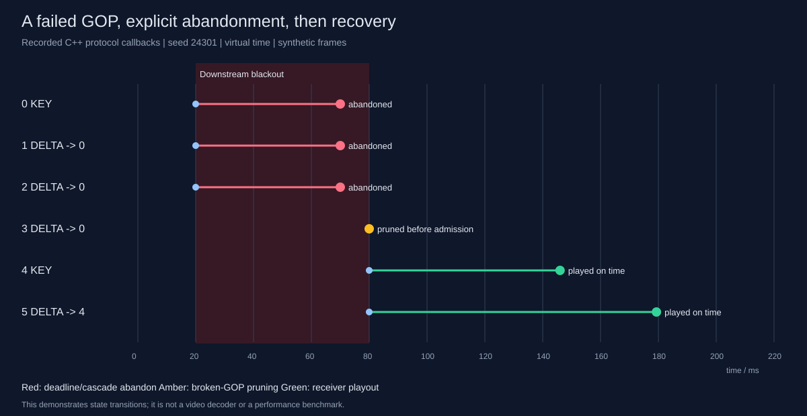

# Controlled GOP recovery demo



```bash
cmake --build build -j4
./build/rudp_demo /tmp/gop-recovery.json
python3 tools/render_demo.py /tmp/gop-recovery.json --svg /tmp/gop-recovery.svg --replay
```

The C++ runner uses the same GatewayNode, ClientNode, sender, receiver and playout
pipeline as the real runtime, with a virtual clock and scripted frame admission:

1. JOIN completes. At 20 ms offer KEY 0 and DELTA 1/2 depending on 0, while all
   downstream DATA and control messages are dropped.
2. KEY 0 reaches its 50 ms budget at 70 ms. Frames 0/1/2 close ABANDONED; the
   gateway emits an upstream keyframe-request callback.
3. At 80 ms DELTA 3 still referencing 0 is rejected before admission. Restore the
   network and explicitly offer KEY 4 plus DELTA 5 referencing 4.
4. ABANDON ranges are retransmitted, the receive sequence space advances, and
   frames 4/5 play on time. The program exits unsuccessfully unless all six source
   offers close with the expected outcomes and zero in-flight state.

The SVG is generated from recorded callbacks, not a manually illustrated result.
`gop-recovery.json` retains the full event stream. Frame offers are a scripted
burst to expose dependency transitions; they are not the 30 fps benchmark load.
Keyframe request here is a source callback, not an implemented RTCP PLI exchange.
No real codec/decoder, camera, or rendered video is claimed.

A separate [real-socket outage experiment](../experiments/socket/README.md)
validates recovery across independent Linux processes with OS scheduling.
